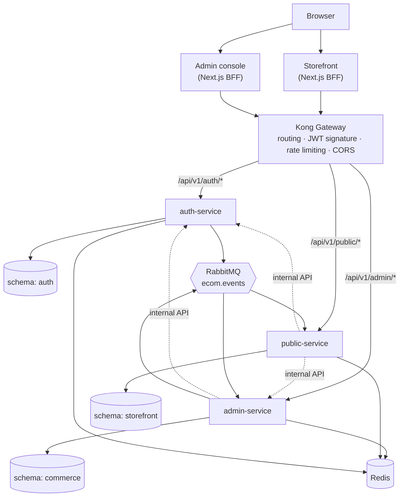
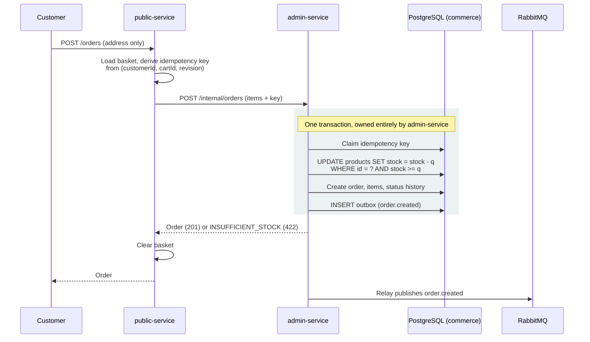
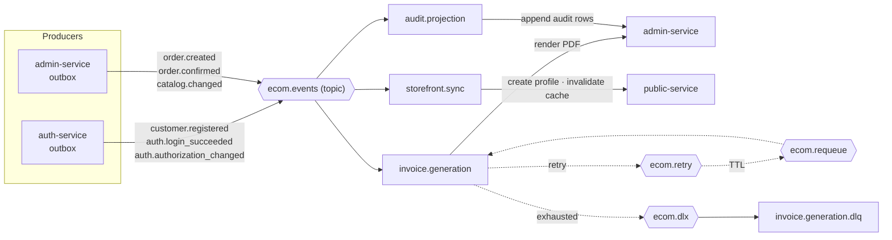

# Architecture

## Shape of the system

Three independently deployable NestJS services sit behind Kong. Each owns one PostgreSQL
schema and one set of write paths. Nothing reads another service's tables.



## Service boundaries and data ownership

| Service | Owns (schema) | Responsible for |
|---|---|---|
| `auth-service` | `auth` | Identities, credentials, RBAC catalogue and assignments, refresh sessions, login attempts |
| `admin-service` | `commerce` | Catalogue, inventory, orders, invoices, audit trail, idempotency records, outbox |
| `public-service` | `storefront` | Customer profiles, saved addresses, shopping baskets |

Each service authenticates to PostgreSQL as its own role. The roles are created with
`NOSUPERUSER NOCREATEDB NOCREATEROLE`, own exactly one schema, and are explicitly revoked
from the other two. A cross-schema write is therefore refused by the database, not merely
discouraged by convention:

```
ERROR:  permission denied for schema auth
```

There is no shared business-logic package. `@ecom/platform` contains only cross-cutting
infrastructure — logging, the response envelope, error codes, the request context, JWT
verification, the Redis and AMQP clients, health probes and the permission *contract*.

## Why orders live in admin-service

Order placement must decrement stock atomically. Stock belongs to the catalogue, so
the service that owns the catalogue must own the order transaction. Splitting them would
require a distributed transaction or a compensating saga for every purchase.

The storefront therefore orchestrates checkout but does not perform it:



The conditional `UPDATE ... WHERE stock_quantity >= q` is the whole overselling defence:
the check and the decrement are one statement, so a losing request updates zero rows and
is rejected. A `CHECK (stock_quantity >= 0)` constraint backs this at the database level.

Items are always processed in sorted order by product id, so two concurrent orders
touching the same two products queue rather than deadlock.

## Event flow



Every event is written to an outbox table **inside the transaction that caused it**. A
relay claims rows with `FOR UPDATE SKIP LOCKED`, publishes them, and marks them published
inside the same transaction. A crash re-delivers; it never loses a committed event. Every
consumer records the message id in `processed_messages`, so a redelivery is a no-op.

## Caching

| Key | Owner | TTL | Invalidated by |
|---|---|---|---|
| `ecom:public:catalog:products:<queryhash>` | public-service | 120 s | `catalog.changed` event |
| `ecom:public:catalog:product:slug:<slug>` | public-service | 120 s | `catalog.changed` event |
| `ecom:public:catalog:categories` | public-service | 120 s | `catalog.changed` event |
| `ecom:public:identity:<userId>` | public-service | 60 s | profile update |
| `ecom:admin:authz:user:<userId>` | admin-service | 60 s | role change + `auth.authorization_changed` |

PostgreSQL is always the source of truth. Redis is fail-open: a cache error is logged and
the loader runs. Stock availability is **never** served from cache.

Permission caching is bounded on two sides — a 60-second TTL *and* explicit invalidation
on any role or status change — so a revoked permission stops working immediately in
practice and within a minute in the worst case.

## Request pipeline

Every request passes through, in order: Kong (routing, JWT signature, rate limit, CORS,
correlation id) → helmet → body parsing → request context (`AsyncLocalStorage`) → global
JWT guard → permission guard → validation pipe → controller → response envelope
interceptor → exception filter.

The request context is established *after* body parsing on purpose: body parsers resolve
from stream events, and an `AsyncLocalStorage` store does not survive that hop. Getting
this wrong silently drops the request id from every error response.

## Failure behaviour

| Failure | Behaviour |
|---|---|
| PostgreSQL unavailable at boot | Connection retried with backoff; readiness reports `error`, container stays unhealthy |
| PostgreSQL unavailable at runtime | `/health` reports `database: down`, readiness 503 |
| Redis unavailable | Cache reads fall through to the owning service; health reports `degraded`, traffic continues |
| RabbitMQ unavailable | Outbox rows accumulate and are relayed when the broker returns; health reports `degraded` |
| Upstream internal API unavailable | Retried with backoff and jitter, then `503 UPSTREAM_UNAVAILABLE` |
| A consumer keeps failing | Retried 5 times via the delay queue, then routed to the queue's dead-letter queue |

## Deliberate non-goals

No Kubernetes, no Kafka, no service mesh, no second datastore and no further service
split. Three services is the smallest division that keeps authentication, commerce and
the storefront independently deployable.
