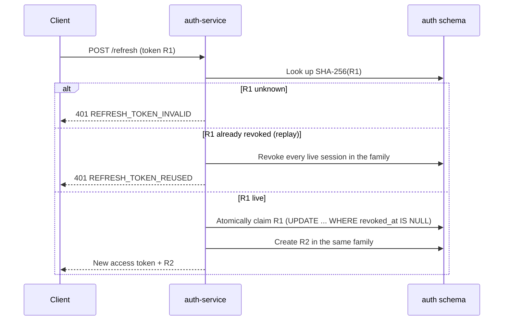
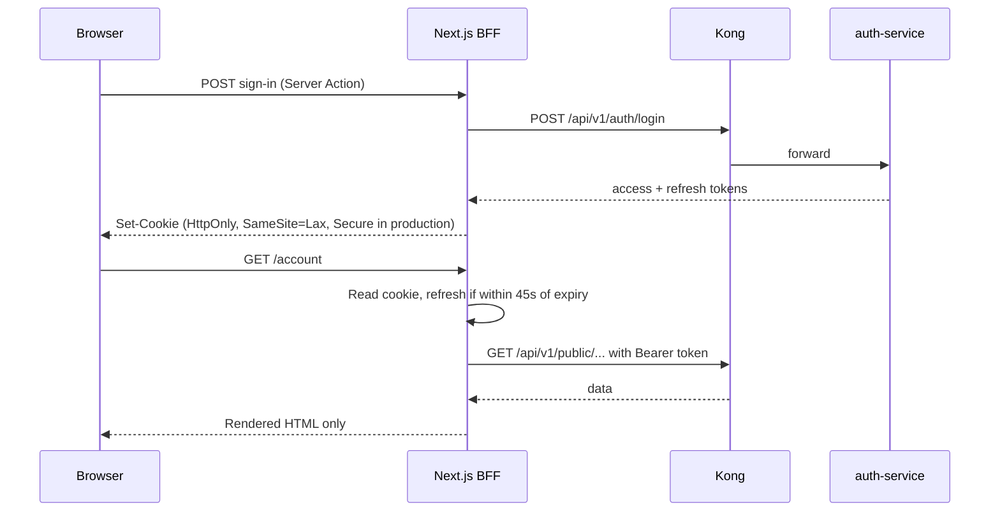

# Authentication

## Tokens

| | Access token | Refresh token |
|---|---|---|
| Format | JWT, RS256 | Opaque, 48 random bytes, base64url |
| Lifetime | 10 minutes (`ACCESS_TOKEN_TTL_SECONDS`, capped at 1 hour) | 14 days |
| Stored | Nowhere on the server | SHA-256 digest only, in `auth.refresh_sessions` |
| Claims | `sub`, `typ`, `roles`, `sid`, `jti`, `iss`, `aud`, `iat`, `nbf`, `exp` | n/a |
| Verified by | Kong (signature, `exp`) and again by each service | auth-service, by digest lookup |

The private key exists only in the auth service. Everything else holds the public key, and
`/api/v1/auth/.well-known/jwks.json` publishes it as a JWKS with a `kid` thumbprint.

No email, name, phone or any other personal data is placed in a token.

## Rotation and reuse detection

A refresh token is single use. Presenting one that was already exchanged means it leaked,
so the **entire family** — every token descended from that login — is revoked, not just the
replayed one.

The claim is a conditional `UPDATE ... WHERE revoked_at IS NULL` whose row count is
checked, so two concurrent refreshes of the same token cannot both succeed.

Revocations that precede a thrown error are committed **outside** the rotation
transaction. Performing them inside would roll the revocation back along with the error,
leaving a leaked family alive — a bug the integration suite covers explicitly.

## Passwords

Argon2id via `@node-rs/argon2`, defaulting to 19 MiB memory, 2 iterations, parallelism 1
(OWASP guidance), all configurable. Failed sign-in for an unknown address still performs a
verification against a dummy hash, so response timing does not reveal which addresses are
registered.

After `LOGIN_MAX_ATTEMPTS` failures (default 8) the account is locked for
`LOGIN_LOCKOUT_MINUTES` (default 15). Kong additionally rate-limits the credential
endpoints by IP.

Changing or resetting a password revokes every session for that account.

## Portal separation

`POST /login` takes a `scope` of `ADMIN` or `CUSTOMER` and refuses to issue a token when it
does not match the account type. A customer account cannot obtain an administrator session
even with correct credentials.

## Browser sessions

The browser never receives a token. Both Next.js applications act as a
backend-for-frontend:

Consequences: no script on the page can read a token, nothing sensitive is in
`localStorage`, and the storefront and admin console use separately named cookies so one
cannot be replayed against the other. Server Actions carry Next.js's built-in origin
check, which covers CSRF for state-changing requests.

## Password reset

No email provider is wired into this build. `POST /password/forgot` always answers `202`
with the same body whether or not the address exists. Outside production the response also
contains `developmentToken` so the flow is testable end to end; in production that field is
absent. Sending the token by email is the one integration point to add.

## Super administrator

Bootstrapped from `SUPER_ADMIN_EMAIL` / `SUPER_ADMIN_PASSWORD` on first start, inside a
transaction guarded by a PostgreSQL advisory lock so concurrent replicas cannot create two.

The account cannot be deleted, suspended, re-roled, or have the super-admin role granted to
anyone else through the API. The password is **not** rewritten from the environment on
every boot — that would make the environment a permanent backdoor. Rotation is deliberate:
set `SUPER_ADMIN_ROTATE_PASSWORD=true`, restart once (the password is replaced and all
sessions revoked), then set it back to `false`.
