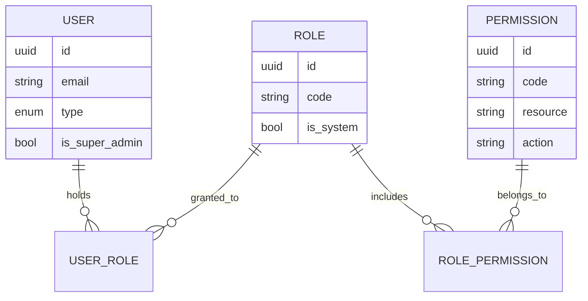

# Authorization

## Model



Permissions are `resource:action` strings — `product:read`, `order:confirm`,
`admin:delete`. The catalogue lives in `@ecom/platform` as a shared contract, so the
service that stores permissions and the service that enforces them can never drift.

### Seeded roles

| Role | Scope |
|---|---|
| `SUPER_ADMIN` | Everything. Protected: not editable, not deletable, not grantable |
| `ADMIN` | Everything except `admin:delete` and the role catalogue |
| `MANAGER` | Catalogue and the order pipeline, customer read/update, audit, dashboard |
| `STAFF` | Read-only support access |
| `CUSTOMER` | Carries no administrative permission at all |

System roles (`SUPER_ADMIN`, `CUSTOMER`) are kept in step with the code catalogue on every
boot. Operator-editable roles are created only when missing, so customised permission sets
survive a deploy.

## Enforcement

Authorization is declared, never hand-rolled in a handler:

```ts
@Post(':id/confirm')
@RequirePermissions(PERMISSIONS.orderConfirm)
confirm(@Param('id') id: string, @CurrentActor() actor: AuditActor) { ... }
```

Three layers, in order:

1. **Kong** — is this JWT genuine and unexpired? Nothing more.
2. **`JwtAuthGuard`** — re-verifies the token against the public key. The gateway is not
   trusted as the only check, so a service reached directly is equally protected.
3. **`PermissionsGuard`** — resolves effective permissions from the auth service, confirms
   the account is an active administrator, and evaluates the declared requirement.

A denial returns `403 PERMISSION_DENIED` and reports which permission was required.

## Ownership checks

Permissions answer "may this role do this?". Ownership answers "is this row theirs?".

Customer-scoped reads always filter by the customer id taken from the verified token, never
from a parameter:

```ts
this.db.knex('orders').where({ id, customer_id: customerId }).first();
```

A wrong id is therefore indistinguishable from a missing one — both return
`404 ORDER_NOT_FOUND` — so the endpoint cannot be used to probe for other customers'
orders. The same rule governs invoice downloads and saved addresses.

## Cache invalidation

Effective permissions are cached in Redis for 60 seconds. Two things invalidate them
sooner: the admin service invalidates directly when it changes a role or account, and the
`auth.authorization_changed` event invalidates on any change made elsewhere. Access tokens
are short-lived, so a revoked permission cannot outlive a token either.

## Interface behaviour

The admin console hides controls the signed-in role cannot use, and the sidebar only lists
sections the account may open. This is a courtesy, not a boundary: every action is
re-authorised server side, and the test suite asserts that a read-only role receives `403`
from the API even when the button is absent.
